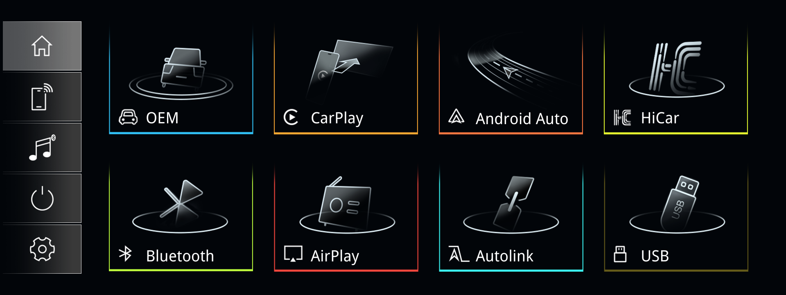
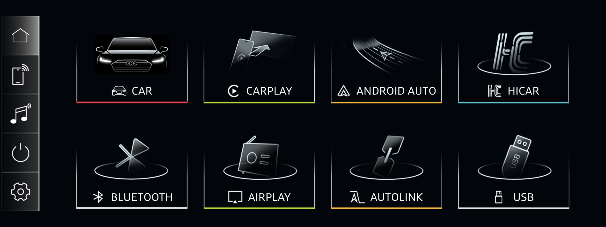
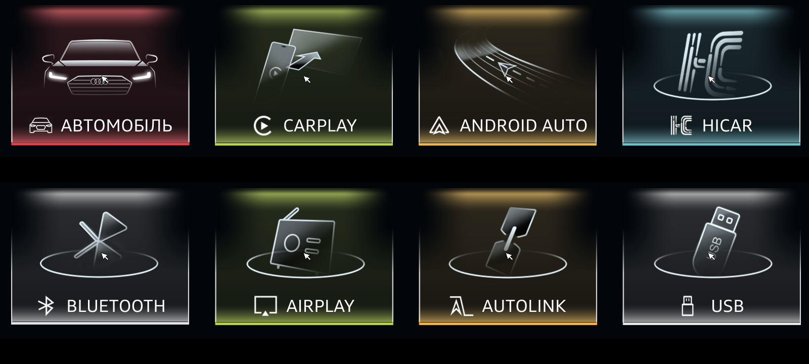
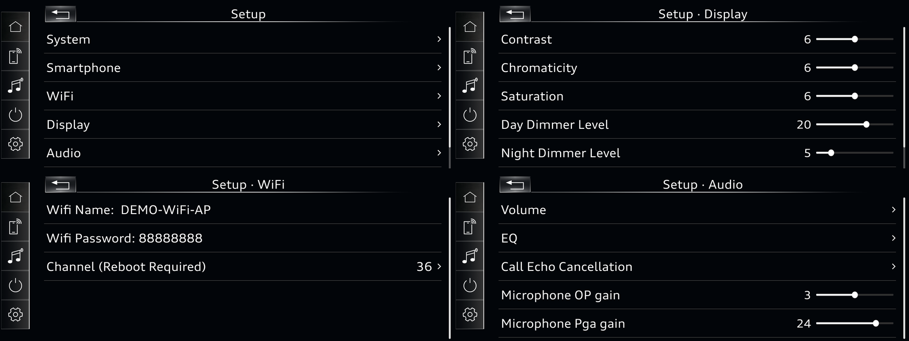
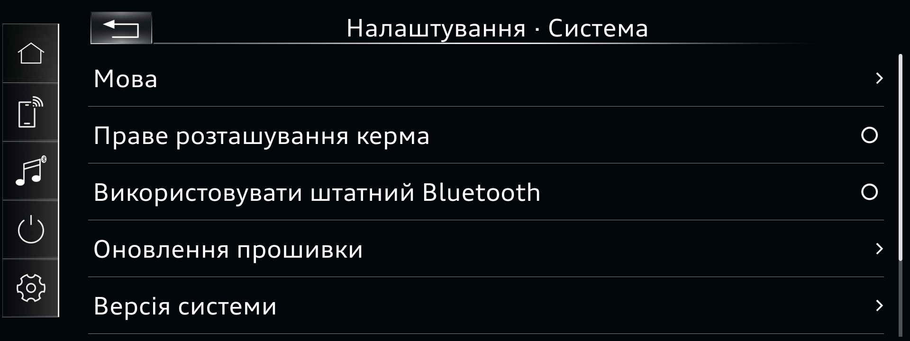
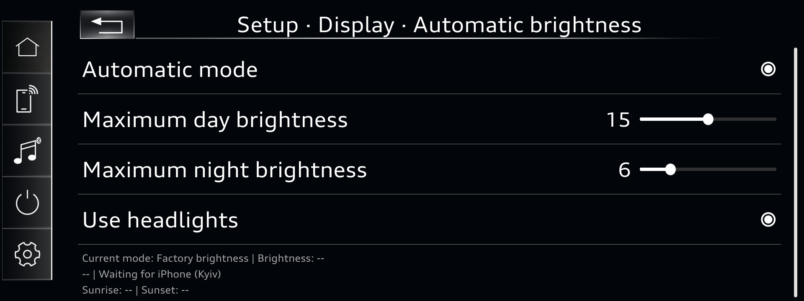

# QD513/QD515 external CarPlay screen firmware, tuned for Audi A4 B9

Offline-built modifications for the Sunplus-based **QD513/QD515 "Audi incell S7"** external
CarPlay / Android Auto / HiCar screens (Linux 4.9, ARMv7, Qt 5.3.2), a hardware family sold for many cars. Base firmware:
`QD513-QD515-AUDI-incell-S7-QA-2026.07.01-v3.0.2`. This build was made for and tested on one
**Audi A4 B9 (2016)**.

The screen is added next to the factory MMI. It is a
personal reverse-engineering project, not a vendor product.

> **Warning: read before doing anything with this.**
> - Flashing a modified firmware can brick the screen. Nothing here is guaranteed safe.
> - The release contains **modified vendor firmware images**. They are derived from the vendor's
>   `v3.0.2` package, which is not mine; I do not own or license the vendor code. Keep your own
>   unmodified firmware and a recovery route before writing anything.
> - Only the owner's unit was ever flashed. Other boards, MCU versions and firmware branches are
>   **not** verified. Do not assume compatibility.
> - Some items below are verified only on the host, on ARM/Qt test harnesses or in the emulator.
>   The status table says which. "Not verified on hardware" means exactly that.

## Download

Release v1.0.0 (installed and working on the owner's unit): see the
[Releases page](https://github.com/yety-ua/qd513-qd515-carplay-screen-audi-a4-b9/releases).
It has two files, `GEMINI_PACK.BIN` and `ISPBOOOT.BIN`, with SHA-256 sums. Check the sums before
using them. The images were built from the stock `v3.0.2` files whose hashes are listed in
`build-manifest.json`; use them only on the same hardware and firmware family.

## What it looks like

Screenshots come from an emulator that runs the real vendor Qt libraries and Launcher
(qemu virt, Cortex-A15, guest-only stubs for hardware services). They are not photos of the car.
Fonts, layout and colours are the packaged assets; the touchscreen and PWM backend are absent in
the emulator.

| Stock home | Modified home |
| --- | --- |
|  |  |

Pressed state of every tile (two static states only, like stock; no animation):

Settings pages (Setup, Display, Wi-Fi, Audio):

Ukrainian is added as a full UI language (shown once here, the System page with the language entry):

## Automatic brightness (new feature)

The stock screen has only manual Day and Night dimmer sliders. This firmware adds a separate
**Settings → Display → Automatic brightness** submenu. The stock sliders stay untouched.

How it works:

- **Solar schedule, fully offline.** Sunrise and sunset come from approximate NOAA solar equations,
  precomputed for 2024..2037 for fixed coordinates (Kyiv, 50.4501 N / 30.5234 E, Europe/Kyiv civil
  time). No GPS, Internet or weather. To use another city the table must be regenerated.
- **Smooth transition.** Smoothstep ramp from 15 minutes before to 15 minutes after sunrise and
  sunset. The night ceiling holds until the morning ramp. Timing is not user-editable.
- **Controls:** Automatic mode, Maximum day brightness (default 15), Maximum night brightness
  (default 6), Use headlights (default on). Levels use the native 0..30 range.
- **Headlights.** The existing MCU light event drives a RAM-only flag with 5 s on / 15 s off
  filtering. In daylight it moves the target 70% from night toward day, never above the day cap.
  Whether the car actually sends this event on every setup is not verified.
- **Clock source.** The screen has no reliable wall clock of its own. Time comes from the iPhone
  (iAP2 DeviceTimeUpdate) and is held as a boot-bound UTC anchor that keeps advancing after the
  phone disconnects. Each boot waits for a fresh anchor and never trusts an old timestamp. Before
  the first sync the last saved automatic level is restored if one exists, otherwise native control.
- **Gentle on flash.** A 40 ms GUI timer moves the PWM by at most 2 duty counts per tick. Stable
  levels are checkpointed at most once a minute plus on sleep, so a sudden power loss can lose the
  latest adjustment. Native sleep level 255 suspends auto changes.
- **Footer** shows mode, actual level, date/time (HH:mm snapshot on menu entry), sync status,
  sunrise and sunset.

Verification so far: solar tests over all 5114 dates, clock/persistence tests on the production
ARM libraries, and vendor-Qt emulator frames of the submenu (sliders persist across reopen).
The owner reports that automatic brightness and the clock work on the device (recorded from the
owner's statement; the detailed PWM, headlight-input and cold-restart logs are not in the repo).

## Other changes relative to stock v3.0.2

| Area | Change | Status |
| --- | --- | --- |
| Localisation | Complete Ukrainian translation (catalogue, fonts checked for glyph fit); new strings also added to all 20 existing catalogues. Switch labels shortened to I / O in Ukrainian only. | Emulator on vendor Qt; installed on the owner's unit |
| Home screen | Redesigned tiles: per-service accent colour on the bottom strip, white side lines, rebuilt car tile (Audi), centred grid. Two states only: normal and pressed (top and bottom edge gradients plus a colour haze). | Emulator and installed build |
| Settings pages | Page header stripe, breadcrumb titles ("Settings · Display"), row gradient and press feedback, scrolling and row selection fixes. | Row gradient and scrolling accepted physically; rest emulator |
| CarPlay | 60 fps request, 512 KiB encoded-video buffers and a guarded two-finger touch shim. Code derived from GeminiTop (MIT), see credits. | Synthetic ARM tests only; physical test still pending |
| OEM tile | The CarPlay "OEM" tile is relabelled Audi MMI and uses the Audi rings artwork. Tapping it opens the external-screen Home (direct return to the factory MMI source was tried and is closed). After forgetting and re-pairing the iPhone the rings appear. | Physically accepted on build 094 |
| Clock | iPhone-sourced offline clock for the solar schedule (see above). | Host/ARM tests; works on the device per the owner |

Unchanged: Wi-Fi/CPU settings, knob/input profile XML, Android Auto and HiCar modules, partition
layout (images are re-packed into the original slots, with 24 KiB / 40 KiB of free space left in
the app / SDK partitions).

## How it is built

The modified files are staged from your own original package with Python tooling, re-packed into the
original partition slots and verified. Packages are byte-reproducible (two independent builds are
compared). The ARM hooks are small position-checked binary patches, each with its own verifier, and
everything was run against real vendor Qt libraries in an emulator. The tooling and build notes are
not part of this repository yet.

Evidence levels are kept apart: static, host, ARM harness, emulator, hardware.

## Related projects and credits

- **[martexas/GeminiTop](https://github.com/martexas/GeminiTop)**: patches and homebrew for the same
  QD513/QD515 Audi incell S7 family (author uses an Audi A1 2014 and base `v2.0.65`). It
  documents the multitouch shim, FPS/buffer tweaks, Wi-Fi VHT80 and the Audi MMI icon in CarPlay.
  The multitouch shim (`cpmt.c`) and the icon artwork here come from it under its MIT licence.
  Please see its README for the hardware background.
- **[danoev/GeminiTop](https://github.com/danoev/GeminiTop)**: a Mercedes-Benz RoadTop fork with
  platform and ABI notes for related units.

If you reuse anything, keep the original licence texts and attribution.

## Licence and disclaimer

Original code and documents in this repository are released under the [MIT License](LICENSE).
Third-party parts (e.g. GeminiTop's `cpmt.c`) keep their own MIT notices.
The firmware images in the Releases page are modified copies of the vendor firmware and remain the
property of their owners; they are shared for interoperability and research, and will be removed on request
of the rights holder.
Provided as is, without warranty. You alone are responsible for what you flash.
